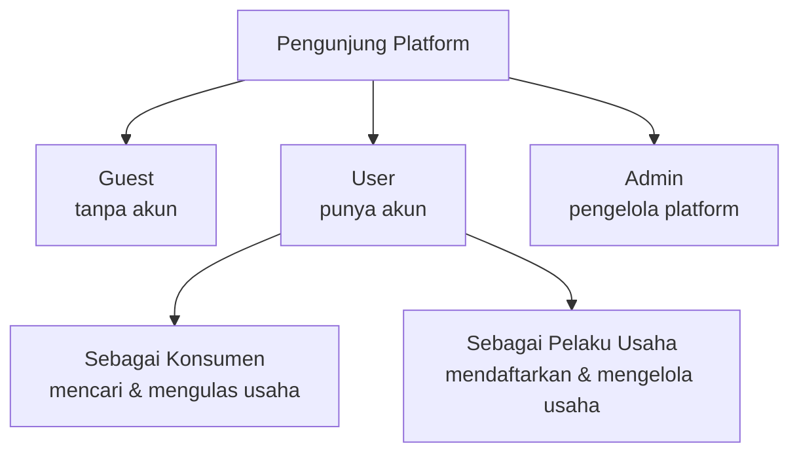
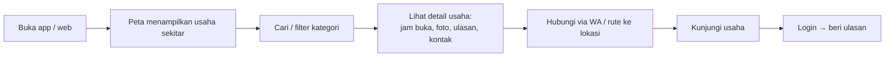
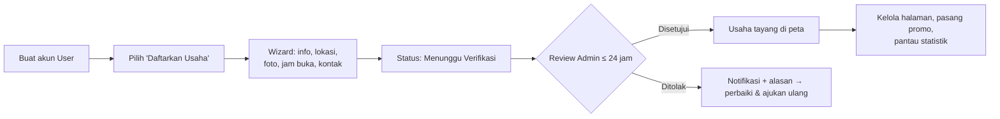

# PRD — PesanLokal

**Platform Direktori & Promosi Usaha Lokal Berbasis Peta**

| | |
|---|---|
| **Versi** | 2.0 (Draft) |
| **Tanggal** | 10 November 2026 |
| **Konteks** | Techcomfest 2027 — Kompetisi Teknologi |
| **Status** | Draft untuk review tim |

---

## 1. Ringkasan Eksekutif

**PesanLokal** adalah platform berbasis peta yang membantu **pelaku usaha lokal mempromosikan usahanya** dan membantu **konsumen menemukan usaha di sekitarnya** dengan informasi yang akurat dan selalu diperbarui.

Mirip Google Maps, tetapi dengan perbedaan fundamental: seluruh usaha **didaftarkan dan dikelola langsung oleh pelaku usahanya sendiri**, sehingga informasi (jam buka, menu/produk, promo, kontak) dijamin akurat karena berasal dari sumber pertama — bukan dari crawling atau kontribusi pihak ketiga yang sering usang. Platform ini sekaligus menjadi media promosi gratis bagi UMKM yang selama ini bingung bagaimana cara memasarkan usahanya secara digital.

> **One-liner:** "Etalase digital usaha lokal — pelaku usaha yang mengisi, konsumen yang menemukan."

---

## 2. Latar Belakang & Masalah

### 2.1 Konteks

- Indonesia memiliki **±65 juta UMKM**, namun sebagian besar tidak punya kehadiran digital yang layak — tidak terdaftar di peta, atau terdaftar dengan informasi yang salah/usang.
- Di Google Maps, usaha kecil sering **tidak muncul**, jam bukanya salah, fotonya tidak ada, atau lokasinya meleset — karena datanya bergantung pada kontribusi pihak ketiga, bukan pemilik usahanya.
- **Kejadian nyata yang melatarbelakangi ide ini:** seorang pengguna mencari warung dan diarahkan ke tempat yang jauh, padahal ada warung serupa yang lebih dekat — hanya saja warung itu tidak terdata di platform mana pun.
- Di sisi lain, pelaku usaha **ingin promosi tapi bingung caranya**: tidak paham iklan digital, tidak punya website, dan media sosial terasa rumit untuk dikelola.

### 2.2 Pernyataan Masalah

> **Bagi konsumen:** "Saya ingin mencari usaha/warung di dekat saya, tapi informasi yang ada tidak akurat — yang dekat tidak terdaftar, yang terdaftar informasinya salah."
>
> **Bagi pelaku usaha:** "Saya ingin usaha saya dikenal orang, tapi saya tidak tahu harus promosi lewat mana dan bagaimana caranya."

### 2.3 Akar Masalah

| Masalah | Akar penyebab |
|---------|---------------|
| Informasi usaha lokal tidak akurat | Data diisi pihak ketiga, bukan pemilik usaha; tidak ada insentif memperbarui |
| Usaha kecil tidak ditemukan | Tidak terdaftar di platform peta; pemilik tidak tahu cara mendaftar |
| Promosi UMKM lemah | Tidak ada kanal promosi yang murah, mudah, dan tepat sasaran (audiens sekitar) |

---

## 3. Tujuan & Sasaran (Goals)

### 3.1 Tujuan Produk

| # | Tujuan | Ukuran Keberhasilan |
|---|--------|---------------------|
| G1 | Pelaku usaha dapat mendaftarkan & mempromosikan usahanya sendiri dengan mudah | Waktu median pendaftaran usaha ≤ 10 menit |
| G2 | Konsumen menemukan usaha terdekat yang relevan dengan informasi akurat | ≥ 90% pencarian menghasilkan usaha dalam radius yang diinginkan |
| G3 | Informasi di platform selalu akurat & terpercaya | ≥ 95% usaha terverifikasi admin; laporan info salah ≤ 5% |
| G4 | Menjadi kanal promosi digital pertama bagi UMKM yang belum terdigitalisasi | ≥ 50% usaha terdaftar belum pernah terdaftar di platform peta lain |

### 3.2 Non-Goals (Di Luar Cakupan v1)

- ❌ Transaksi/pemesanan & pembayaran di dalam aplikasi
- ❌ Logistik atau pengantaran
- ❌ Navigasi turn-by-turn sendiri (cukup integrasi/deep-link ke aplikasi peta)
- ❌ Iklan berbayar & monetisasi kompleks
- ❌ Fitur sosial media penuh (feed, follow antar pengguna)

---

## 4. Role & Persona

### 4.1 Struktur Role

| Role | Deskripsi | Hak Akses Utama |
|------|-----------|-----------------|
| **Guest** | Pengunjung tanpa akun | Melihat peta, mencari & melihat detail usaha (read-only) |
| **User** | Pengguna terdaftar — satu akun bisa berperan sebagai **konsumen** dan/atau **pelaku usaha** | Konsumen: ulasan, favorit, lapor info salah. Pelaku usaha: daftarkan & kelola usaha, pasang promo |
| **Admin** | Pengelola platform | Verifikasi usaha, moderasi konten & ulasan, kelola kategori, dashboard statistik |

### 4.2 Persona

**Persona 1 — Bu Siti, 48 th** *(User — Pelaku Usaha)*
- Punya warung makan rumahan; pelanggannya hanya orang yang kebetulan lewat.
- Ingin usahanya dikenal lebih luas, tapi tidak paham cara promosi digital.
- **Kebutuhan:** cara daftar yang gampang (cukup dari HP), halaman usaha yang bisa dibagikan ke WhatsApp, cara pasang info promo.

**Persona 2 — Rafi, 24 th** *(User — Konsumen / Guest)*
- Anak kos yang sering cari makan/jasa di sekitar tempat tinggalnya.
- Frustrasi karena Google Maps sering menunjukkan tempat jauh atau sudah tutup permanen.
- **Kebutuhan:** peta usaha terdekat yang akurat, filter kategori, jam buka yang benar, ulasan jujur.

**Persona 3 — Andi, 27 th** *(Admin)*
- Pengelola platform; bertanggung jawab atas kualitas & kepercayaan data.
- **Kebutuhan:** antrian verifikasi usaha yang efisien, alat moderasi ulasan/laporan, statistik pertumbuhan platform.

---

## 5. Solusi & Proposisi Nilai

### 5.1 Proposisi Nilai

| Untuk | PesanLokal memberikan | Berbeda dari Google Maps karena |
|-------|----------------------|--------------------------------|
| Pelaku usaha | Etalase digital gratis + kanal promosi ke audiens sekitar | Dirancang untuk UMKM: pendaftaran mandiri super mudah, fitur promo, tanpa biaya iklan |
| Konsumen | Penemuan usaha terdekat dengan info akurat dari sumber pertama | Semua data diisi & diperbarui pemilik usaha, diverifikasi admin |
| Ekosistem lokal | Pemetaan lengkap usaha mikro yang selama ini "tak terlihat" | Fokus hyperlocal & UMKM, bukan tempat besar/komersial |

### 5.2 Prinsip Desain

1. **Source-of-truth dari pemilik** — informasi usaha hanya diubah oleh pemiliknya; konsumen bisa melapor jika salah.
2. **Verifikasi sebelum tayang** — usaha baru ditinjau admin agar platform tetap terpercaya.
3. **Sederhana untuk non-teknis** — jika bisa pakai WhatsApp, bisa mendaftarkan usaha.
4. **Peta sebagai antarmuka utama** — penemuan berbasis lokasi, bukan daftar teks.
5. **Satu peta, empat wajah** — peta hadir di setiap role, tetapi tampilannya disesuaikan dengan kebutuhan masing-masing role (lihat §5.3).

### 5.3 Peta sebagai Fitur Utama di Setiap Role

Peta adalah layar utama (home) untuk **semua** role — bukan fitur tambahan. Setiap role mendapat varian tampilan peta yang berbeda, dengan standar UI premium (spesifikasi visual lengkap di [design.md](design.md)):

| Role | Nama Varian | Fokus Tampilan | Pembeda Visual Utama |
|------|-------------|----------------|----------------------|
| **Guest** | *Explore Map* | Penemuan cepat tanpa friksi | Peta terang & bersih, pin berwarna per kategori, kartu preview usaha muncul dari bawah (bottom sheet), CTA lembut "Masuk untuk menyimpan" |
| **User — Konsumen** | *Personal Map* | Personalisasi & promo | Pin favorit berbentuk hati, badge promo menyala (pulse) pada pin usaha berpromo, chip filter melayang, jejak usaha yang pernah diulas |
| **User — Pelaku Usaha** | *Business Map* | Performa & jangkauan usaha | Pin usaha sendiri menonjol (besar + glow kuning), lingkaran radius jangkauan, heatmap asal penonton halaman, panel statistik mengambang |
| **Admin** | *Command Map* | Pengawasan & moderasi | Tema gelap (midnight navy), pin berwarna status (kuning = menunggu verifikasi, biru = tayang, merah = dilaporkan), clustering jumlah, klik pin → panel aksi verifikasi |

**Acceptance criteria:** keempat varian menggunakan basemap & komponen yang sama (satu codebase peta), dibedakan lewat layer, tema, dan pin — bukan empat implementasi terpisah.

---

## 6. Fitur & Kebutuhan Fungsional

### 6.1 MVP (Fase 1) — *Must Have*

#### A. Guest

| ID | Fitur | Deskripsi |
|----|-------|-----------|
| F1 | Peta usaha sekitar | Peta interaktif menampilkan usaha dalam radius tertentu dari lokasi pengguna |
| F2 | Pencarian & filter | Cari berdasarkan nama/kategori (kuliner, jasa, toko, dll.) + filter jarak & status buka |
| F3 | Detail usaha | Halaman usaha: foto, deskripsi, kategori, jam buka, alamat + pin peta, kontak (WA/telepon), ulasan |
| F4 | Rute ke lokasi | Deep-link ke Google Maps/aplikasi peta untuk navigasi |
| F5 | Ajakan daftar | Guest diarahkan membuat akun saat ingin mengulas/menyimpan/mendaftarkan usaha |

**Acceptance criteria:** Guest dapat menemukan dan melihat detail usaha terdekat **tanpa login**, ≤ 3 tap dari layar awal.

#### B. User — sebagai Konsumen

| ID | Fitur | Deskripsi |
|----|-------|-----------|
| F6 | Registrasi & login | Daftar dengan nomor HP/email + OTP |
| F7 | Ulasan & rating | Rating 1–5 + komentar pada usaha; satu ulasan per pengguna per usaha |
| F8 | Favorit | Simpan usaha ke daftar favorit |
| F9 | Lapor informasi salah | Laporkan usaha tutup permanen / lokasi salah / info usang → masuk antrian admin |

#### C. User — sebagai Pelaku Usaha

| ID | Fitur | Deskripsi |
|----|-------|-----------|
| F10 | Pendaftaran usaha | Wizard: nama usaha → kategori → pin lokasi di peta → foto → jam buka → kontak. Status awal: *Menunggu Verifikasi* |
| F11 | Kelola halaman usaha | Edit semua informasi usaha kapan saja (perubahan besar dapat memicu re-review) |
| F12 | Katalog produk/layanan | Daftar produk/menu/jasa dengan foto & harga (opsional, tanpa transaksi) |
| F13 | Promo & pengumuman | Pasang banner promo/diskon/pengumuman berbatas waktu di halaman usaha |
| F14 | Statistik sederhana | Jumlah kunjungan halaman, pencarian yang menampilkan usaha, klik kontak |
| F15 | Bagikan halaman usaha | Link publik usaha yang bisa disebarkan via WA/status/medsos |

**Acceptance criteria:** pelaku usaha non-teknis menyelesaikan F10 ≤ 10 menit (uji moderated, 8/10 peserta lolos).

#### D. Admin

| ID | Fitur | Deskripsi |
|----|-------|-----------|
| F16 | Verifikasi usaha | Antrian usaha baru: tinjau → setujui / tolak (dengan alasan) |
| F17 | Moderasi konten | Tinjau ulasan & laporan konsumen; takedown konten melanggar |
| F18 | Kelola kategori | CRUD kategori usaha |
| F19 | Kelola pengguna | Suspend/blokir akun yang melanggar |
| F20 | Dashboard statistik | Jumlah usaha (per status/kategori/wilayah), pengguna aktif, tren pendaftaran |
| F21 | Command Map | Peta moderasi bertema gelap: pin berwarna status (menunggu/tayang/dilaporkan), clustering, aksi verifikasi langsung dari pin (lihat §5.3) |

**Acceptance criteria:** admin dapat memproses verifikasi 1 usaha ≤ 2 menit; SLA verifikasi ≤ 24 jam.

### 6.2 Fase 2 — *Should Have*

| Fitur | Deskripsi |
|-------|-----------|
| Verifikasi berjenjang | Badge "Terverifikasi" dengan bukti kepemilikan (foto tempat usaha + KTP) |
| Notifikasi promo sekitar | Konsumen dapat notifikasi promo dari usaha favorit/terdekat (opt-in) |
| Pencarian produk lintas usaha | Cari "sate ayam" → semua usaha terdekat yang menjualnya |
| Balasan ulasan | Pelaku usaha dapat membalas ulasan konsumen |
| Multi-foto & jam buka kompleks | Galeri foto, jam buka berbeda per hari/libur |

### 6.3 Fase 3 — *Could Have*

- Event & bazar lokal di peta (kolaborasi komunitas/pemda).
- Fitur pemesanan/reservasi sederhana (evolusi ke transaksi).
- Rekomendasi personalisasi berdasarkan riwayat pencarian.
- API publik untuk pemerintah daerah / peneliti UMKM.

---

## 7. Kebutuhan Non-Fungsional

| Kategori | Kebutuhan |
|----------|-----------|
| **Performa** | Peta & daftar usaha termuat ≤ 3 detik pada jaringan 3G/perangkat low-end; pencarian ≤ 1 detik |
| **Ketersediaan** | Uptime ≥ 99% |
| **Keamanan** | OTP rate-limited; RBAC ketat per role (Guest/User/Admin); data pribadi sesuai UU PDP; sanitasi input (anti-XSS/injeksi) |
| **Akurasi lokasi** | Pin lokasi presisi ≤ 20 m; geocoding dua arah (alamat ↔ koordinat) |
| **Aksesibilitas** | Bahasa sederhana, target sentuh besar, kontras WCAG AA |
| **Konsistensi UI** | Seluruh tampilan mengikuti design system di [design.md](design.md): palet 60-30-10 (powder blue / midnight navy / sunflower yellow), komponen & varian peta per role |
| **Skalabilitas** | Mendukung 10.000 usaha & 100.000 MAU; query geospasial terindeks (geohash/PostGIS) |

---

## 8. Alur Pengguna Utama

### 8.1 Alur Konsumen Menemukan Usaha

### 8.2 Alur Pelaku Usaha Mendaftarkan Usaha

---

## 9. Metrik Keberhasilan (North Star & KPI)

**North Star Metric:** jumlah **koneksi konsumen→usaha per minggu** (klik kontak WA/telepon + klik rute).

| KPI | Target 3 Bulan | Target 6 Bulan |
|-----|---------------|----------------|
| Usaha terdaftar & terverifikasi | 150 | 750 |
| Koneksi konsumen→usaha / minggu | 500 | 3.000 |
| MAU konsumen | 2.000 | 10.000 |
| Median waktu pendaftaran usaha | ≤ 10 mnt | ≤ 7 mnt |
| SLA verifikasi admin | ≤ 24 jam | ≤ 12 jam |
| Laporan info salah per usaha aktif | ≤ 5% | ≤ 3% |

**Metrik pengaman (guardrail):** rasio usaha ditolak verifikasi ≤ 20%; rasio ulasan dimoderasi ≤ 5%.

---

## 10. Analisis Kompetitif

| Aspek | Google Maps | Instagram/medsos | **PesanLokal** |
|-------|-------------|------------------|----------------|
| Sumber data usaha | Crawling + kontribusi pihak ketiga | Pemilik (tapi tak terstruktur) | **Pemilik usaha, terstruktur & terverifikasi** |
| Akurasi info UMKM mikro | ⚠️ sering salah/tidak ada | ⚠️ tidak ada lokasi/jam baku | ✅ |
| Kemudahan daftar bagi UMKM | ⚠️ rumit (Business Profile, verifikasi lama) | ✅ mudah tapi bukan untuk discovery lokal | ✅ wizard ≤ 10 menit |
| Penemuan berbasis lokasi | ✅ | ❌ | ✅ fokus hyperlocal |
| Fitur promosi gratis tepat sasaran | ❌ (berbayar/terbatas) | ⚠️ tergantung follower | ✅ promo tampil ke pengguna sekitar |

**Positioning:** PesanLokal tidak melawan Google Maps sebagai alat navigasi — ia mengisi celah **direktori UMKM mikro yang akurat dan dikelola pemiliknya sendiri**, segmen yang paling buruk terlayani di platform besar.

---

## 11. Asumsi, Risiko & Mitigasi

### Asumsi Kunci (perlu divalidasi)
1. Pelaku usaha mau meluangkan waktu mendaftar & memperbarui informasi jika prosesnya mudah dan manfaatnya terlihat (statistik kunjungan).
2. Konsumen mau membuka aplikasi baru selain Google Maps untuk pencarian usaha lokal.
3. Verifikasi admin manual masih feasible di skala awal.

### Risiko & Mitigasi

| Risiko | Dampak | Kemungkinan | Mitigasi |
|--------|--------|-------------|----------|
| Cold start dua sisi (sedikit usaha → sedikit konsumen) | Tinggi | Tinggi | Luncurkan per-wilayah (density-first); onboarding kolektif via komunitas/kelurahan; tim melakukan seeding usaha awal |
| Data menjadi usang (pemilik malas update) | Tinggi | Sedang | Fitur lapor info salah; pengingat berkala; badge "diperbarui X hari lalu" |
| Usaha fiktif / spam | Sedang | Sedang | Verifikasi admin wajib sebelum tayang; verifikasi berjenjang di Fase 2 |
| Bottleneck verifikasi admin saat skala naik | Sedang | Sedang | Checklist verifikasi efisien, auto-flag duplikat, rekrut moderator wilayah |
| Konsumen tetap memakai Google Maps | Tinggi | Sedang | Fokus pada usaha yang *tidak ada* di Google Maps; SEO halaman publik usaha agar ditemukan dari pencarian web |

---

## 12. Rencana Rilis

| Fase | Lingkup | Timeline (indikatif) |
|------|---------|---------------------|
| **Alpha** | F1–F5 (Guest) + F10, F16 (daftar & verifikasi), seeding 20 usaha di 1 wilayah pilot | Minggu 1–6 |
| **Beta** | Semua fitur MVP (F1–F20), 1 kecamatan, feedback loop mingguan | Minggu 7–12 |
| **v1.0 (Demo Techcomfest)** | MVP stabil + data pilot nyata (usaha & pengguna aktual) sebagai bukti traction | Minggu 13–16 |
| **v1.x** | Fitur Fase 2 berdasarkan prioritas feedback | Pasca-kompetisi |

---

## 13. Pertanyaan Terbuka

1. Bentuk produk: web app (PWA) dulu, aplikasi Android native, atau keduanya? (Kecenderungan: **PWA-first** agar Guest bisa akses tanpa install dan halaman usaha bisa di-SEO.)
2. Penyedia peta: Google Maps API (akurat, berbayar) vs OpenStreetMap/Leaflet (gratis, perlu effort)?
3. Apakah satu akun User boleh mendaftarkan lebih dari satu usaha?
4. Verifikasi admin v1: cukup review data, atau wajib bukti foto tempat usaha?
5. Radius default penemuan: 1 km, 2 km, atau bisa diatur pengguna?
6. Strategi seeding wilayah pilot pertama — di mana dan bekerja sama dengan siapa (RW/kelurahan/komunitas UMKM)?

---

## 14. Lampiran

- **Glossarium:** UMKM = Usaha Mikro, Kecil & Menengah; RBAC = Role-Based Access Control; PWA = Progressive Web App; MAU = Monthly Active Users; SLA = Service Level Agreement.
- **Referensi:** evidence board Figma "PesanLokal — Product Planning" (Techcomfest 2027).
- **Design system:** [design.md](design.md) — palet warna, tipografi, komponen, dan spesifikasi varian peta per role.

---

*Dokumen ini adalah living document — perbarui setelah setiap siklus validasi dengan pengguna.*
